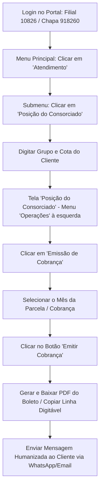

# Skill: Emissão de 2ª Via no Portal Magalu e Gestão de Funil (Jarvis)

## 🎯 Objetivo
Permitir que o **Jarvis** navegue com precisão pelo Portal do Consórcio Magalu para extrair a Posição do Consorciado e emitir a 2ª via do boleto em PDF, seguindo o passo a passo exato da interface do portal.

---

## 🧭 Passo a Passo Exato de Navegação no Portal Magalu

### Detalhes das Telas e Menus:

1. **Acesso Inicial:**
   - **URL:** `https://portal.consorciomagalu.com.br/portal-consorcio/login`
   - **Filial:** `10826` | **Chapa:** `918260` | **Senha:** `Magalu5177*`

2. **Navegação de Atendimento:**
   - Acesse a aba **Atendimento** no topo.
   - Selecione **Posição do Consorciado**.

3. **Busca de Carteira:**
   - Preencha o **Grupo** (ex: `006042`) e **Cota** (ex: `0782-00`) ou busque pelo **CPF** no CRM.

4. **Operações de Cobrança (Menu Lateral Esquerdo):**
   Na tela da *Posição do Consorciado*, localize o menu lateral esquerdo **Operações** e execute:
   - Clicar na 3ª opção: **`Emissão de Cobrança`**.
   - Selecionar o mês vigente da parcela.
   - Clicar em **`Emitir Cobrança`**.
   - O sistema gerará o arquivo **PDF** atualizado com o boleto.

---

## 💬 Diálogo Interativo do Jarvis

Caso os dados de Grupo e Cota não estejam identificados na carteira do cliente, o Jarvis dirá:

> *"Com certeza! Para eu acessar a aba **Atendimento > Posição do Consorciado** no Portal Magalu e emitir a cobrança, por favor me informe:*
> 
> 1. 👤 **CPF do Cliente** (ou Grupo e Cota)
> 2. 🗓️ **Mês de referência** da cobrança que deseja emitir
> 
> *Assim que me passar, acerto a emissão e trago o boleto em PDF para você!"*
